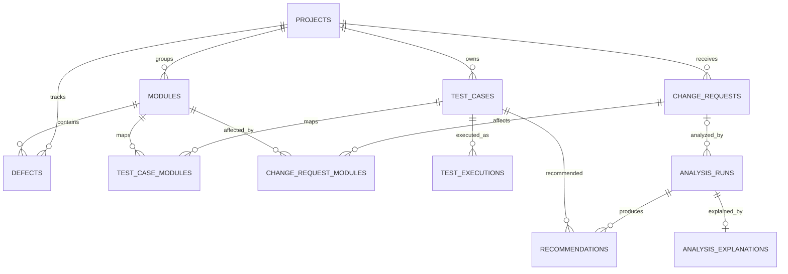

# Database Architecture Report

## Executive Summary

The project contains two SQLite database files:

- `tests/testimpact.db` — the file selected by the current `DATABASE_URL` configuration.
- `testimpact.db` — the fallback file selected when `DATABASE_URL` is not set.

Both files currently have identical schemas: 11 tables covering projects, modules,
test cases, defects, test executions, change requests, impact-analysis runs,
recommendations, and LLM explanations. The schema contains useful foreign keys,
uniqueness rules, indexes, and recommendation checks. It does not contain
repository/commit data, source-code structure, dependency graphs, or test coverage
records.

The application loads `DATABASE_URL` and constructs its SQLAlchemy engine in
[`app/database.py`](app/database.py). SQLite foreign-key enforcement is enabled
for application connections. The configured database passed SQLite's
`integrity_check` and had no `foreign_key_check` violations when inspected.

This report documents schema metadata only; it does not inspect or disclose
application row contents. Declared column types and constraints below were
verified against both SQLite files. ORM-level defaults are identified separately
from SQL-level defaults.

## Database Files and Connection Configuration

| File | Role |
|---|---|
| `tests/testimpact.db` | Current configured SQLite target from `DATABASE_URL`. |
| `testimpact.db` | Fallback target in `app/database.py` if `DATABASE_URL` is absent. |

Both files have the same tables, column definitions, constraints, and indexes.
The application calls `Base.metadata.create_all()` during startup in
[`app/main.py`](app/main.py); this creates missing tables but is not a versioned
schema migration mechanism.

The configured engine uses SQLite's `check_same_thread=False` option and turns on
`PRAGMA foreign_keys=ON` for each SQLAlchemy connection. This pragma is
connection-local: an independent raw SQLite connection will report foreign-key
enforcement off unless it enables the pragma itself.

## Complete Schema Documentation

SQLite reports no SQL-level `DEFAULT` clauses for these tables. Defaults noted
below are SQLAlchemy/Python-side defaults and apply when rows are created through
the application ORM; direct SQL inserts do not inherit them. Primary-key integer
IDs are generated by SQLite/SQLAlchemy autoincrement behavior. The ORM marks
date-time fields timezone-aware, but SQLite's `DATETIME` type does not itself
enforce or preserve a timezone type.

### TABLE: `projects`

Columns:
- `id` (`INTEGER`, NOT NULL, autoincrement)
- `name` (`VARCHAR(120)`, NOT NULL)
- `description` (`TEXT`, nullable)
- `created_at` (`DATETIME`, NOT NULL; ORM default: current UTC time)

Primary Key:
- `id`

Foreign Keys:
- None

Unique constraints:
- `name`

Indexes:
- `ix_projects_id` (non-unique)
- `ix_projects_name` (unique)

Purpose:
- Top-level grouping for the application's test assets, defects, modules, and
  change requests.

### TABLE: `modules`

Columns:
- `id` (`INTEGER`, NOT NULL, autoincrement)
- `project_id` (`INTEGER`, NOT NULL)
- `name` (`VARCHAR(120)`, NOT NULL)
- `description` (`TEXT`, nullable)

Primary Key:
- `id`

Foreign Keys:
- `project_id` -> `projects.id` (`ON DELETE RESTRICT`)

Unique constraints:
- (`project_id`, `name`) — module names must be unique within a project.

Indexes:
- `ix_modules_id` (non-unique)
- `ix_modules_name` (non-unique)
- `ix_modules_project_id` (non-unique)
- `sqlite_autoindex_modules_1` (unique on `project_id`, `name`)

Purpose:
- Project-scoped functional areas used to group test cases and defects and to
  identify modules affected by a change request. These are application modules,
  not source-code files or AST symbols.

### TABLE: `test_cases`

Columns:
- `id` (`INTEGER`, NOT NULL, autoincrement)
- `project_id` (`INTEGER`, NOT NULL)
- `title` (`VARCHAR(255)`, NOT NULL)
- `steps` (`TEXT`, NOT NULL)
- `expected_result` (`TEXT`, NOT NULL)
- `priority` (`VARCHAR(50)`, NOT NULL)

Primary Key:
- `id`

Foreign Keys:
- `project_id` -> `projects.id` (`ON DELETE RESTRICT`)

Unique constraints:
- None

Indexes:
- `ix_test_cases_id` (non-unique)
- `ix_test_cases_priority` (non-unique)
- `ix_test_cases_project_id` (non-unique)
- `ix_test_cases_title` (non-unique)

Purpose:
- Stores manual or logical test-case definitions and their project association.
  Module associations are represented by `test_case_modules`.

### TABLE: `test_executions`

Columns:
- `id` (`INTEGER`, NOT NULL, autoincrement)
- `test_case_id` (`INTEGER`, NOT NULL)
- `status` (`VARCHAR(20)`, NOT NULL)
- `build_version` (`VARCHAR(100)`, nullable)
- `executed_at` (`DATETIME`, NOT NULL; ORM default: current UTC time)

Primary Key:
- `id`

Foreign Keys:
- `test_case_id` -> `test_cases.id` (`ON DELETE RESTRICT`)

Unique constraints:
- None

Indexes:
- `ix_test_executions_id` (non-unique)
- `ix_test_executions_status` (non-unique)
- `ix_test_executions_test_case_id` (non-unique)

Purpose:
- Records execution history for test cases, including status, build version,
  and execution time. It does not store line-, file-, or function-level coverage.

### TABLE: `defects`

Columns:
- `id` (`INTEGER`, NOT NULL, autoincrement)
- `project_id` (`INTEGER`, NOT NULL)
- `module_id` (`INTEGER`, NOT NULL)
- `title` (`VARCHAR(255)`, NOT NULL)
- `description` (`TEXT`, NOT NULL)
- `resolution_notes` (`TEXT`, nullable)
- `severity` (`VARCHAR(50)`, NOT NULL)
- `created_at` (`DATETIME`, NOT NULL; ORM default: current UTC time)

Primary Key:
- `id`

Foreign Keys:
- `project_id` -> `projects.id` (`ON DELETE RESTRICT`)
- `module_id` -> `modules.id` (`ON DELETE RESTRICT`)

Unique constraints:
- None

Indexes:
- `ix_defects_id` (non-unique)
- `ix_defects_module_id` (non-unique)
- `ix_defects_project_id` (non-unique)
- `ix_defects_severity` (non-unique)
- `ix_defects_title` (non-unique)

Purpose:
- Tracks project- and module-scoped defects, including descriptive and
  resolution information. There is no direct foreign key from a defect to a
  test case or test execution.

### TABLE: `change_requests`

Columns:
- `id` (`INTEGER`, NOT NULL, autoincrement)
- `project_id` (`INTEGER`, NOT NULL)
- `title` (`VARCHAR(255)`, NOT NULL)
- `description` (`TEXT`, NOT NULL)
- `status` (`VARCHAR(50)`, NOT NULL; ORM default: `submitted`)
- `created_at` (`DATETIME`, NOT NULL; ORM default: current UTC time)

Primary Key:
- `id`

Foreign Keys:
- `project_id` -> `projects.id` (`ON DELETE RESTRICT`)

Unique constraints:
- None

Indexes:
- `ix_change_requests_id` (non-unique)
- `ix_change_requests_project_id` (non-unique)
- `ix_change_requests_status` (non-unique)
- `ix_change_requests_title` (non-unique)

Purpose:
- Represents a generic project change request. It can be associated with
  affected modules through `change_request_modules`; it does not contain
  GitHub pull-request identifiers, commits, branches, or diffs.

### TABLE: `test_case_modules`

Columns:
- `test_case_id` (`INTEGER`, NOT NULL)
- `module_id` (`INTEGER`, NOT NULL)

Primary Key:
- (`test_case_id`, `module_id`)

Foreign Keys:
- `test_case_id` -> `test_cases.id` (`ON DELETE CASCADE`)
- `module_id` -> `modules.id` (`ON DELETE RESTRICT`)

Unique constraints:
- Composite primary key prevents duplicate test-case/module pairs.

Indexes:
- Composite primary-key index on (`test_case_id`, `module_id`)
  (`sqlite_autoindex_test_case_modules_1`)

Purpose:
- Join table implementing the many-to-many relationship between test cases and
  modules.

### TABLE: `change_request_modules`

Columns:
- `change_request_id` (`INTEGER`, NOT NULL)
- `module_id` (`INTEGER`, NOT NULL)

Primary Key:
- (`change_request_id`, `module_id`)

Foreign Keys:
- `change_request_id` -> `change_requests.id` (`ON DELETE CASCADE`)
- `module_id` -> `modules.id` (`ON DELETE RESTRICT`)

Unique constraints:
- Composite primary key prevents duplicate change-request/module pairs.

Indexes:
- Composite primary-key index on (`change_request_id`, `module_id`)
  (`sqlite_autoindex_change_request_modules_1`)

Purpose:
- Join table implementing the many-to-many relationship between change
  requests and affected modules.

### TABLE: `analysis_runs`

Columns:
- `id` (`INTEGER`, NOT NULL, autoincrement)
- `change_request_id` (`INTEGER`, nullable)
- `status` (`VARCHAR(50)`, NOT NULL; ORM default: `running`)
- `created_at` (`DATETIME`, NOT NULL; ORM default: current UTC time)
- `completed_at` (`DATETIME`, nullable)

Primary Key:
- `id`

Foreign Keys:
- `change_request_id` -> `change_requests.id` (`ON DELETE SET NULL`)

Unique constraints:
- None

Indexes:
- `ix_analysis_runs_id` (non-unique)
- `ix_analysis_runs_change_request_id` (non-unique)
- `ix_analysis_runs_status` (non-unique)

Purpose:
- Records each impact-analysis execution, its optional originating change
  request, lifecycle status, and timestamps.

### TABLE: `recommendations`

Columns:
- `id` (`INTEGER`, NOT NULL, autoincrement)
- `analysis_run_id` (`INTEGER`, NOT NULL)
- `test_case_id` (`INTEGER`, NOT NULL)
- `rank` (`INTEGER`, NOT NULL)
- `score` (`FLOAT`, NOT NULL)
- `impact_level` (`VARCHAR(50)`, NOT NULL)
- `reason` (`TEXT`, NOT NULL)
- `score_breakdown` (`JSON`, NOT NULL)
- `supporting_evidence` (`JSON`, NOT NULL)
- `review_status` (`VARCHAR(50)`, NOT NULL; ORM default: `pending`)
- `created_at` (`DATETIME`, NOT NULL; ORM default: current UTC time)

Primary Key:
- `id`

Foreign Keys:
- `analysis_run_id` -> `analysis_runs.id` (`ON DELETE CASCADE`)
- `test_case_id` -> `test_cases.id` (`ON DELETE RESTRICT`)

Unique constraints:
- (`analysis_run_id`, `test_case_id`) — one recommendation per test case per run.
- (`analysis_run_id`, `rank`) — one recommendation per rank per run.

Check constraints:
- `score >= 0.0 AND score <= 100.0`
- `review_status IN ('pending', 'accepted', 'rejected')`

Indexes:
- `ix_recommendations_id` (non-unique)
- `ix_recommendations_analysis_run_id` (non-unique)
- `ix_recommendations_rank` (non-unique)
- `ix_recommendations_review_status` (non-unique)
- `ix_recommendations_test_case_id` (non-unique)
- `sqlite_autoindex_recommendations_1` (unique on `analysis_run_id`,
  `test_case_id`)
- `sqlite_autoindex_recommendations_2` (unique on `analysis_run_id`, `rank`)

Purpose:
- Stores ranked test-case impact recommendations and their score, rationale,
  evidence, and review decision for an analysis run.

### TABLE: `analysis_explanations`

Columns:
- `id` (`INTEGER`, NOT NULL, autoincrement)
- `analysis_run_id` (`INTEGER`, NOT NULL)
- `model_name` (`VARCHAR(255)`, NOT NULL)
- `overall_summary` (`TEXT`, NOT NULL)
- `risk_observations` (`JSON`, NOT NULL)
- `recommendation_explanations` (`JSON`, NOT NULL)
- `limitations` (`JSON`, NOT NULL)
- `created_at` (`DATETIME`, NOT NULL; ORM default: current UTC time)

Primary Key:
- `id`

Foreign Keys:
- `analysis_run_id` -> `analysis_runs.id` (`ON DELETE CASCADE`)

Unique constraints:
- `analysis_run_id` is unique; at most one explanation is stored per analysis run.

Indexes:
- `ix_analysis_explanations_id` (non-unique)
- Unique index on `analysis_run_id`

Purpose:
- Persists a generated LLM summary, risk observations, per-recommendation
  explanations, limitations, and model name for an analysis run.

## Relationship Mapping

### One-to-One

- `analysis_runs` to `analysis_explanations`: one run has zero or one explanation.
  The unique, non-null `analysis_explanations.analysis_run_id` enforces at most
  one explanation per run; a run may exist without one.

### One-to-Many

- `projects` to `modules`
- `projects` to `test_cases`
- `projects` to `defects`
- `projects` to `change_requests`
- `test_cases` to `test_executions`
- `change_requests` to `analysis_runs` (an analysis run may have no change request)
- `analysis_runs` to `recommendations`
- `test_cases` to `recommendations`
- `modules` to `defects`

### Many-to-Many

- `test_cases` to `modules`, through `test_case_modules`
- `change_requests` to `modules`, through `change_request_modules`

### Mermaid ER Diagram

## Business-Level Data Model and Flow

1. A `projects` row scopes the core test-management records. A project can have
   multiple `modules`, `test_cases`, `defects`, and `change_requests`.
2. Test cases and change requests are each associated with modules through their
   respective join tables. Test cases also belong directly to a project.
3. Executions are attached to test cases. Defects are attached to a project and
   module, but **not** to an execution or test case. A defect and execution can
   only be related indirectly when their module context overlaps; no such
   defect-to-execution link is stored or enforced.
4. An impact-analysis request creates an `analysis_runs` record, retrieves
   project-scoped historical context from the application's Chroma vector store,
   computes and ranks candidate test cases, then persists `recommendations`.
   The run is marked completed or failed by the analysis workflow.
5. An optional LLM explanation is generated for a completed run and persisted in
   `analysis_explanations`. Review decisions update
   `recommendations.review_status`.

The schema's foreign keys verify that referenced rows exist, but they do not
enforce that a change request's modules, a test case's modules, or a defect's
module all belong to the same project as the parent record. That consistency
must be validated by application logic or strengthened with composite keys and
constraints.

## Current-State Assessment

- **Core test-impact data:** Present — projects, modules, test cases, executions,
  defects, change requests, analysis runs, recommendations, and explanations.
- **Referential integrity:** Foreign keys are declared. SQLAlchemy enables
  SQLite enforcement on its connections; the inspected configured database has
  no foreign-key violations.
- **Integrity and schema parity:** The configured database passed
  `PRAGMA integrity_check`; the configured and fallback files have identical
  schema definitions.
- **Constraints:** Module names are unique within projects; project names are
  unique; recommendations have per-run uniqueness and score/review-status
  checks. Other status/severity/priority values are not constrained in SQLite.
- **Defaults:** Timestamps and several statuses have ORM-side defaults, but
  there are no SQL-level defaults in the physical schema.
- **Vector retrieval:** The relational database does not store vectors. The
  application uses a separate persistent Chroma store, configured independently
  from the SQLite database. Its collection is populated from test cases,
  defects, and executions.
- **Schema evolution:** Startup uses `Base.metadata.create_all()`; no migration
  revision history is represented in the inspected database.
- **Traceability gap:** Defects cannot be linked directly to failing executions
  or affected test cases. Execution records also lack result details such as
  logs, artifacts, and coverage.

## Future-State Assessment

“Supported” below means supported by the current SQLite relational schema. A
feature implemented by another application component or external store is called
out separately.

| Feature | Supported | Missing tables/entities | Assessment |
|---|---|---|---|
| A. GitHub Repository Integration | **NO** | `repositories`, `repository_installations`, `branches` | No repository provider, owner, installation, branch, or credential-reference data is modeled. Credentials should be held in a secrets manager, not stored directly in these tables. |
| B. Pull Request Analysis | **NO** | `pull_requests`, `commits`, `pull_request_commits`, `file_changes` | `change_requests` can hold generic title/description/status, but not GitHub PR identity, base/head refs, commits, changed files, or diff versions. |
| C. AST-based Code Analysis | **NO** | `code_components`, `functions`, `ast_snapshots` | No source file, symbol, AST, language, revision, or code-range records exist. |
| D. Code Dependency Mapping | **NO** | `dependency_edges`, `component_dependencies` | `modules` represent product/application groupings; there is no code-level dependency graph between files, symbols, or components. |
| E. Test Coverage Tracking | **NO** | `coverage_runs`, `coverage_mappings`, `coverage_files` | `test_executions` records outcome/status and build version, not which code each test covers or coverage by revision. |
| F. Vector Embeddings / RAG | **NO (SQLite)** | `document_chunks`, `embedding_metadata`, `vector_index_versions` | The SQLite schema has no chunks or embeddings. The application does provide RAG using an external persistent Chroma store, so this is an application-level capability outside the relational schema. |
| G. Impact Analysis Recommendations | **YES** | None for the current persisted workflow | `analysis_runs` and `recommendations` persist run lifecycle, ranked test cases, scores, evidence, and review status. Reproducible snapshots and scoring-version metadata would improve auditability. |
| H. LLM Explanation Storage | **YES** | None for one explanation per run; optional `llm_invocations` / `prompt_versions` for richer provenance | `analysis_explanations` persists the explanation and model name, with one explanation per run. It does not separately record prompts, provider/version, token usage, or retries. |

## Gap Analysis and Recommendations

To evolve this schema into a production-grade, code-aware Test Impact Analysis
platform, prioritize:

1. **Repository and change provenance:** Add repository/provider installations
   (with secret references only), branches, pull requests, commits, PR-to-commit
   links, and changed-file records. Store the base/head commit SHAs used for
   every analysis.
2. **Versioned code model:** Add code components/files and function or symbol
   records keyed by repository revision. Add directed dependency edges with edge
   type and source location so dependency graphs can be rebuilt per revision.
3. **Coverage and execution detail:** Add coverage runs and mappings from
   test executions to files, lines, or symbols at a specific commit. Store
   execution artifacts/log references and explicit failure/defect mappings.
4. **RAG lineage:** Keep vector values in Chroma or another vector store, but
   persist relational metadata for document chunks, source-record IDs, content
   hashes, embedding model/version, collection/index version, and indexing time.
5. **Analysis reproducibility:** Persist analysis input snapshots, repository
   revision, algorithm/scoring version, retrieval/index version, and model
   configuration. Existing JSON evidence is useful but should be linked to
   stable source records and snapshots.
6. **Cross-project integrity:** Enforce that module associations and defects
   belong to the same project as their test case/change request/defect. Consider
   composite unique keys and composite foreign keys, or explicit service-level
   validation with tests.
7. **Operational controls:** Add users/organizations and authorization
   membership if the product is multi-tenant; add audit events for changes and
   recommendation reviews. Keep tenant ownership explicit on core entities.
8. **Schema migrations and lifecycle rules:** Introduce versioned migrations
   before production schema changes. Add database-level defaults/checks for
   critical status fields where portability permits, and define retention,
   deletion, backup, and recovery policies.

The existing schema is a sound relational starting point for project-scoped
test management and persisted recommendation workflows. Its main limitation for
future impact analysis is missing code/revision/coverage lineage; without those
entities, it cannot explain a recommendation in terms of changed code and
measured test-to-code coverage.
