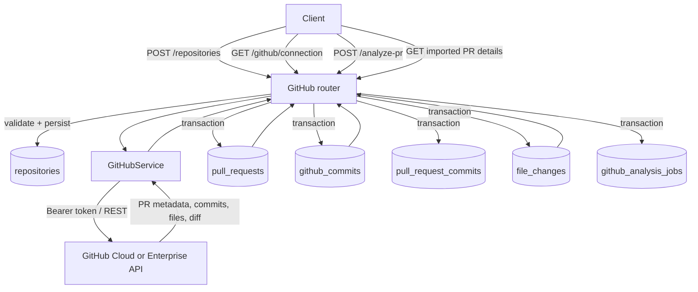

# Phase 1 (GitHub Integration) — Discovery

Validation date: 2026-11-17

## Result

The GitHub integration is implemented through repository registration, authenticated GitHub API calls, PR import, and database persistence. The focused tests and an additional in-memory API exercise pass for those flows. Phase 1 is **partially validated, not fully accepted**: no live GitHub request was made because no target repository/PR was specified, and the PR details API returns commit SHAs without commit messages.

## Relevant files

| File | Purpose |
|---|---|
| `app/services/github_service.py` | GitHub API client; reads token and timeout configuration; checks authentication; fetches PR metadata, paginated commits/files, and diff; maps API/network errors. |
| `app/routers/github.py` | Repository registration/listing, connection and PR import/detail endpoints; validates upstream payloads; coordinates persistence and import jobs. |
| `app/schemas/github.py` | Pydantic request/response contracts and repository URL/provider validation. |
| `app/models/github.py` | SQLAlchemy models for repositories, PRs, commits, changed files, and GitHub analysis jobs. |
| `app/models/github_associations.py` | PR-to-commit many-to-many association table. |
| `app/models/__init__.py` | Imports GitHub models and association so SQLAlchemy metadata registers them. |
| `app/routers/__init__.py` | Exports the GitHub router for application registration. |
| `app/main.py` | Registers the GitHub router and creates tables with `Base.metadata.create_all`. |
| `app/database.py` | Configures SQLAlchemy database URL, engine, SQLite foreign-key enforcement, and DB sessions. |
| `tests/test_github_integration.py` | Focused tests for authenticated request construction/error mapping, repository registration and conflict behavior, PR persistence, and re-import idempotency. |
| `README.md` | Documents GitHub token configuration and repository/PR import workflow. |
| `tests/testimpact.db` | Database selected by the current environment configuration during this validation; currently has the GitHub tables and one repository row, but no imported PR rows. |
| `testimpact.db` | Default-path database file; currently has no GitHub tables. |

No separate repository/DAO layer was found: the router performs SQLAlchemy queries and transactions directly. GitHub API transport is separated into `GitHubService`; request validation and persistence orchestration live in the router. No migration framework or migration scripts were found; runtime schema initialization relies on `Base.metadata.create_all`.

## Phase 1 architecture

The application has no GitHub repository-fetch endpoint or standalone commit/file endpoints. Repository information is available from the registered-repository API; PR details, changed files, commit SHAs, and diff are returned together by the imported-PR detail endpoint.
